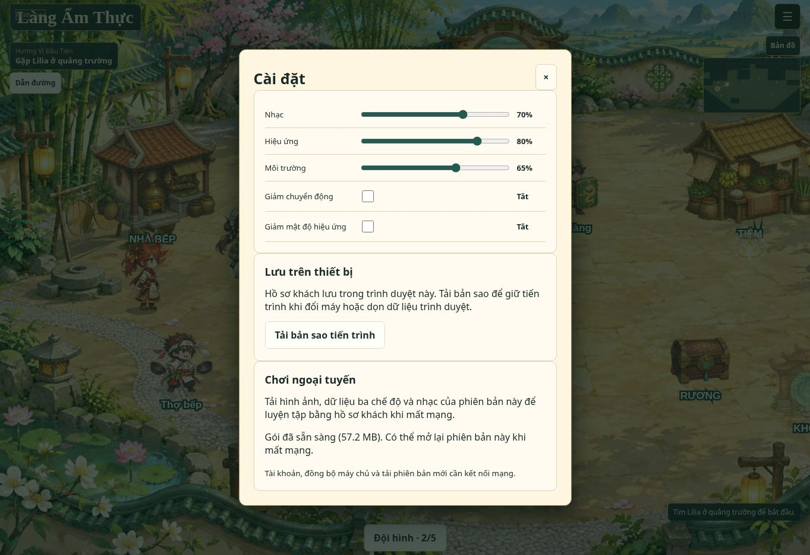

# Đối chiếu spec trên nền mobile-navigation-combat

Nền triển khai: `codex/mobile-navigation-combat`, commit `baa4db88ee86676030102d749d3531cac206414c`. Nhánh này có 52 commit sau nền `c4918c2` của bản nâng cấp trước. Tích hợp theo mã nguồn mới này; không chép đè client cũ từ master.

| Yêu cầu | Triển khai được giữ và phần bổ sung |
| --- | --- |
| Ba chế độ dùng chung nhận diện nhân vật | Giữ 24 Vị Linh, hình gốc, atlas/rig, gacha và tiến trình hiện tại; chỉ số riêng từng mode. Không đổi danh mục thành bộ năm nhân vật của prototype cũ. |
| Adventure, di chuyển mobile, farm và boss | Giữ sáu chương, nhà NPC, joystick/minimap, tìm đường/chống kẹt, các vùng farm lặp lại, kho đồ, chế tạo, checkpoint giao tranh và cơ chế đối phó boss. |
| TCG có năm ô quân, hai ô bẫy, phản ứng và hệ | Giữ bảng v4, 60 lá, bộ 24 lá, nhiều bộ/difficulty, chọn bẫy, stack, mục tiêu, hộ vệ và công thức hệ. Ván/deck legacy tiếp tục theo phiên bản đã lưu. Không đưa bộ 36 lá reference vào ván v4. |
| Auto Chess: shop năm ô, ghế chín ô, ba sao, kinh tế công bằng | Giữ lưới hex 7×8, kho hữu hạn dùng chung, XP, hiệp lực, trang bị, bảy bot có ví/shop thật, đấu cặp và ghost, neutral/elite và replay. |
| Auto Chess kết thúc khi còn một người | Bổ sung `finish_condition: last_survivor` cho ván mới. Vòng 37 chuyển sang hiệp phụ thay vì chấm TOP 1 theo HP khi còn đối thủ. Luật phụ áp dụng giống nhau cho người và bot; tiebreak có thể lặp lại sau reload. Số cân bằng và tiebreak vẫn **PROPOSED**. Save thiếu trường mới giữ cap cũ. |
| Nhịp giao tranh chậm 30%, boss có nhạc riêng | Giữ hệ số playback 70% và các soundtrack thực tế của nền mobile. Không nối lại voice/TTS hội thoại đang tắt. Không thay nhạc gốc bằng âm tổng hợp của prototype. |
| PWA và ngoại tuyến | Giữ manifest/icon/fullscreen; thêm gói tải chủ động từ Cài đặt cho hồ sơ khách. Vite tạo danh mục SHA-256 và worker theo build, tải có giới hạn đồng thời, loại bỏ gói thiếu và chỉ đánh dấu đủ sau mọi tệp. Gồm cả chunk Phaser, catalog, bản đồ, art và nhạc boss. Bỏ voice đã ngừng sử dụng khỏi gói tải. |
| Lưu và cập nhật an toàn | Giữ save v2 và server/cloud-save hiện tại. Ghi cục bộ lỗi quota/security trả về thất bại, giữ bản cũ và trạng thái đang chơi, hiển thị thử lại/tải JSON. Không chuyển release khi save khách chưa ghi được. Không cache API, auth, release pointer hay request ghi. |
| Bản phát hành có phiên bản | Giữ publisher/launcher `release.json`, thư mục bất biến và kiểm tra ván chưa kết thúc trước cập nhật. Cache tách theo origin/scope/build; activate không xóa cache release khác. |

Không tạo hoặc nhập thêm asset nghệ thuật/âm thanh từ bên thứ ba trong lần tích hợp này. Các bản ghi nguồn gốc và phần cần duyệt nghệ thuật của nhánh nền được giữ nguyên.

## Kiểm tra tự động

Chạy từ thư mục dự án:

```bash
npm --prefix client ci
node --test client/tests/*.test.js
python -m unittest discover -s tests -v
npm --prefix client run typecheck
npm --prefix client run build
python scripts/validate_package.py .
```

Bổ sung kiểm thử cho kết thúc/hiệp phụ/các cặp bot/reload/legacy, lỗi ghi thiết bị và backup, gói tải tái lập được, tải thiếu giữ bản cũ, mở shell/chunk/catalog/nhạc ngoại tuyến, bỏ qua API/auth, và cách ly cache giữa các release. GitHub Actions chạy cùng bộ kiểm tra trên Node 24 và Python 3.11. Cập nhật `FILE_INDEX.json` sau khi sửa nguồn bằng `python scripts/update_file_index.py .`.

## Kiểm tra trình duyệt

1. Mở bản build HTTPS, tạo hồ sơ khách, hoàn tất hai starter; thử điều hướng ba mode và Cài đặt ở màn dọc/ngang.
2. Tải gói ngoại tuyến, đợi báo đã tải đủ; mở lại đúng phiên bản và kiểm tra không thiếu shell/Phaser, catalog hoặc atlas.
3. Ngắt mạng, tải lại: vào hồ sơ khách, Adventure/TCG/Auto Chess; tiến trình trên máy vẫn giữ. Đăng nhập và đồng bộ máy chủ cần mạng.
4. Giả lập storage quota/security: thông báo lỗi hiện, tải JSON được, retry thành công khi ghi được trở lại; không chuyển release trước khi lưu.
5. Kiểm tra điện thoại thật (iOS/Android), cài PWA và âm lượng/hiệu năng/khả năng giữ cache sau dọn bộ nhớ vẫn thuộc nghiệm thu thiết bị. Không suy ra đã đạt production từ unit test.

### Kết quả kiểm tra tích hợp

- **166/166 JavaScript**, **66/66 Python**; TypeScript và Vite production build thành công. Gói ngoại tuyến hiện có **311 tệp, 57,2 MiB**. Giữ toàn bộ art/rig hiện tại, các soundtrack đang khai báo và nhạc boss; không tải art prototype, voice tắt và hai bản nhạc không được dùng. Fingerprint bao gồm nội dung worker để thay chính sách cache không ghi đè cache đang dùng.
- Trình duyệt Chrome, viewport 1363×936: tạo hồ sơ khách, nhận hai starter, tải gói, đóng tab/mở lại để worker chờ được activate. Máy chủ preview đã **dừng** trước khi reload. Game vẫn vào sảnh, mở Adventure, TCG và Auto Chess từ cache.
- Khi máy chủ dừng: mua ba Tiêu Tinh → hợp thể 2 sao → xếp quân → thắng vòng quái, nhận Giáp Đồng và 6 vàng. TCG giữ bộ 24 lá, hiển thị năm ô quân/hai ô bẫy, triệu hồi Bún Bò Hỏa Linh rồi bot xử lý phản ứng. Adventure vẫn tải bản đồ làng và dùng dẫn đường.
- Tải bản sao JSON khi ngoại tuyến: đúng format backup và save version 2; tên hồ sơ, quân 2 sao của ván cờ và snapshot TCG còn nguyên. Cài đặt đọc được marker gói hoàn tất khi máy chủ không phục vụ.
- Lần thử gói 80 MiB đã bắt được lỗi quota và giữ game hoạt động; gói đã tinh gọn còn 57,2 MiB. Static live-reload preview sửa HTML nên không thể vượt SRI; chuyển kiểm tra sang máy chủ Vite **production preview** (giữ nguyên kiểm tra SHA-256). Không hạ kiểm tra toàn vẹn để làm preview chạy.
- Chưa nghiệm thu thiết bị iOS/Android thật hoặc toàn bộ sáu chương bằng thao tác tay. Công cụ emulation trong browser kiểm thử bị chặn; không tuyên bố đã hoàn tất kiểm tra viewport điện thoại bằng trình duyệt này. Kiểm thử camera dọc/ngang, input và collision tự động hiện có vẫn chạy cùng bộ regression.


